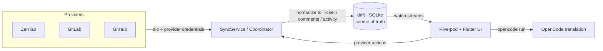

# WorkNexus

**One place to read and act on every ticket.** WorkNexus is a local-first desktop
workspace for developers who work across **ZenTao, GitLab, and GitHub**. It syncs
provider data into a local SQLite read model, normalizes it as `Ticket`, and then
shows each source with the workflow it actually uses: ZenTao bugs/tasks, GitLab
issues/MRs, and GitHub issues/PRs.

<sub>🇬🇧 English · <a href="README.vi.md">🇻🇳 Tiếng Việt</a></sub>

> **Status:** early development · Windows/macOS desktop · private project. Built with
> Flutter/Dart on a feature-first Clean Architecture.

---

## Hall of Fame

Thanks to everyone whose code has been merged into `main`. 🏆

| | Contributor | Highlights |
|:-:|---|---|
| <a href="https://github.com/thanhnguyen293"></a> | **[Thanh Nguyen](https://github.com/thanhnguyen293)** | 🥇 Creator & maintainer — architecture, providers, board, task detail, ZenTao chat |
| <a href="https://github.com/dyno-nexsoft"></a> | **[Dyno (dyno-nexsoft)](https://github.com/dyno-nexsoft)** | 🥈 In-app updater, API-key translation, release CI & installers (incl. Linux AppImage), Quill chat composer, paged ZenTao boards, mini apps, custom app name & icon |
| <a href="https://github.com/phungbuuquang"></a> | **[Michael (phungbuuquang)](https://github.com/phungbuuquang)** | 🥉 Desktop tray menus, window & profile polish (Windows/macOS) |
| <a href="https://github.com/baby-hero-404"></a> | **[baby-hero (baby-hero-404)](https://github.com/baby-hero-404)** | 🏅 Modular tool architecture (`ToolModule` registry) and the workspace shell rework — rail, nav panes, workspace overview |

<a href="https://github.com/thanhnguyen293/WorkNexus/graphs/contributors">
  
</a>

---

## Why WorkNexus?

Work often lives in several trackers at once. WorkNexus gives you one desktop
surface for triage, reading, filtering, commenting, provider actions, attachment
preview, and machine translation without jumping between several browser tabs.

- **Local-first.** drift/SQLite is the single source of truth. Network sync writes
  into the database; the Flutter UI reads reactive streams from the database, so
  cached tickets keep working offline.
- **Unified, not flattened.** All sources become `Ticket`s, but each board keeps
  provider-native lifecycle columns and actions instead of forcing every provider
  through one generic status model.
- **Secure by default.** Credentials are stored with `flutter_secure_storage`
  (macOS Keychain). Authenticated media loads attach tokens only to the provider
  host, not to arbitrary third-party asset/CDN hosts.

---

## UI Showcase & Navigation Architecture

The workspace shell organizes every tool into a 5-level hierarchy:
`Workspace (L1) → Account (L2) → Section (L3) → Scope (L4) → Item (L5)`.
The rail picks the workspace or one of its accounts, the nav pane picks a section and
its scope (a project, product or repository), the viewport shows that section, and a
ticket opens in the detail slide-over.

> Screenshots of the current app are on their way; the earlier design mockups were
> removed because they no longer matched it.

### Desktop window anatomy

The workspace overview, as the app shows it (dark theme, macOS):

```text
┌────────────────────────────────────────────────────────────────────────────────────────┐
│ • • •  [W] MyWorkspace ▾ / Overview      [ Search tasks, bugs, PRs, MRs…  Cmd+K ]  [⚙] │
├──────────┬───────────────────────────┬─────────────────────────────────────────────────┤
│ Workspace│ WORKSPACE / MYWORKSPACE   │ Overview                   Manage integrations  │
│ ──────── │ > Overview                │ ┌ GitHub ─────┐ ┌ ZenTao ─────┐ ┌ GitLab ─────┐ │
│ ZenTao   │   Integrations         3  │ │ PRs  Issues │ │ Tasks  Bugs │ │ Projs  MRs  │ │
│ GitHub   │   Members                 │ │ [Open →]    │ │ [Open →]    │ │ [Open →]    │ │
│ GitLab   │   Settings                │ └─────────────┘ └─────────────┘ └─────────────┘ │
│ ──────── │                           │ ┌ ZenTao · account ───────────────────────────┐ │
│ Zentao   │                           │ │ My tasks              │ My bugs             │ │
│ Trello   │                           │ │ Executions            │ Recent activity     │ │
│ CI/CD    │                           │ └─────────────────────────────────────────────┘ │
│ + Add    │                           │ ┌ Assigned to you · from all tools ───────────┐ │
│ ──────── │                           │ │ BUG-…   …                         confirmed │ │
│ Bell     │                           │ │ TASK-…  …                         wait      │ │
│ Update   │                           │ └─────────────────────────────────────────────┘ │
│ + Connect│                           │                                                 │
└──────────┴───────────────────────────┴─────────────────────────────────────────────────┘
  76px rail  300px nav pane                viewport   ◄── 460px detail slide-over (a ticket)
```

| Zone | Size | What it holds |
|---|---|---|
| **Title bar** | `52pt` on macOS (traffic lights centred in it) · `56px` on Windows/Linux (with caption buttons) | Workspace switcher and breadcrumb (`Workspace ▾ / Account / Section / Scope`), **contextual search** (`Ctrl/Cmd+K`) whose placeholder follows where you are, and the **Quick settings** button. |
| **Rail** | `76px` | **Workspace** (`Ctrl/Cmd+1`), then one button per connected account (`Ctrl/Cmd+2…9`) with unread chat badges; your **mini apps** with **+ Add**; and at the bottom **Notifications**, the **update** button (when a release is ready) and **+ Connect**. |
| **Nav pane** | `300px` | In the workspace: *Overview*, *Integrations*, *Members*, *Settings*. In a tool: its section tabs and a scope list — filter, pinned and recent scopes, and the project/product trees (ZenTao) or repositories (GitHub/GitLab). Hidden while a mini app or the ticket editor fills the window. |
| **Viewport** | flexible | The section itself, in its view modes; the last 3 sections stay alive (LRU) so switching back is instant. |
| **Detail slide-over** | `460px` | Opens from the right when you open a ticket: header actions, description with **Original / Translation**, comments and timeline, plus a back history of the tickets opened. |
| **Side panels** | overlay | **Notifications** slides out beside the rail; **Quick settings** (appearance, layout, chat, cache) from the right. |

### Sections per tool

| Tool | Sections (L3) | Scopes (L4) | View modes |
|---|---|---|---|
| **Workspace** | Overview · Integrations · Members · Settings | — | Overview: tool cards, the ZenTao section (*My tasks*, *My bugs*, *Executions*, *Recent activity*) and **Assigned to you** from all tools |
| **ZenTao** | Chat · Tasks · Bugs (Docs, Executions: listed, not built yet) | conversations · projects/executions · products | Tasks: List, Kanban (Calendar and Gantt placeholders) · Bugs: Board, List |
| **GitHub** | Pull requests · Issues (Actions: not built yet) | repositories | PRs: Open, Merged, Closed, Board · Issues: List, Board |
| **GitLab** | Merge requests · Issues (Pipelines: not built yet) | projects | MRs: Open, Merged, Closed, Board · Issues: List, Board |

Also in the shell:

- **Mini apps** — any website pinned to the rail and shown inside the app, with
  links from chat, tickets and other pages routed to it (see [Mini apps](#mini-apps)).
- **Your own name and icon** — the window title, taskbar/Alt-Tab and tray carry
  the name and (on Windows) the image you choose in Quick settings › Appearance.

---

## Features

### Unified workspace shell

- **5-level navigation:** Title bar → per-account rail → tool nav pane → section viewport → detail slide-over.
- **Per-account rail** with provider-colored icons; `Ctrl/Cmd+1…9` keyboard shortcuts for quick switching.
- **Workspace sections:** Overview (card grid + Assigned work), Integrations (health pills + Manage), Members (coming soon), Settings.
- **Overview cards** show per-account metrics (open count, assigned count, last sync) with skeleton loading.
- **"Assigned to you"** list aggregates work from all accounts in the active workspace with smart reason chips (reviewer, assignee).
- **Workspace switcher** popover with search, keyboard nav, and "Create workspace" action.
- **Contextual search** (`Ctrl/Cmd+K`): ranked local ticket search with title/key/description weighting and keyboard-navigable results overlay.
- **State persistence:** per-workspace nav location (section, scope, view mode) is saved on every navigation change and restored on launch or workspace switch.
- **Section caching:** the viewport keeps the last 3 sections alive off-stage (with suspended tickers/focus) for instant switching.
- **Error boundary:** each section is wrapped in `SectionErrorBoundary` that catches rendering errors and shows a retry prompt instead of crashing the app.

### Source-specific boards and tool sections

- **ZenTao** — Chat, Tasks (List / Kanban / Calendar† / Gantt†), Bugs (Board / List), Docs†, Sprints†.
- **GitLab** — Merge Requests (Open / Merged / Closed / Board), Issues (List / Board), Pipelines†.
- **GitHub** — Pull Requests (Open / Merged / Closed / Board), Issues (List / Board), Actions†.
- † = planned sections rendered as `ComingSoonView` with a "Switch to…" action.
- Scopes: projects, products, or repositories with pinned-first ordering and recent history.
- Provider-native board columns:
  - ZenTao bugs: new/unconfirmed, confirmed/to-fix, resolved/verify,
    postponed, non-fix, closed.
  - ZenTao tasks: not started, in progress, paused, done/verify, closed,
    canceled.
  - GitLab/GitHub issues: open, in progress, closed.
  - GitLab/GitHub MRs/PRs: draft, review, merged, closed.
- Context-aware filters with data-derived facets for workspace, provider,
  account, assignee, status, priority, labels, and search.
- Server-side slices with offline fallback: when a selected tab/project/repo —
  or a single paged column — cannot refresh, cached tickets still render from
  the local database.
- Paged columns prune cached tickets the server no longer lists as their pages
  load, but keep those of a column the loaded pages have not reached yet
  (Postponed and Non-Fix share ZenTao's `toclosed` view with Resolved), so
  their cards survive a refresh.

### Multi-provider connections

| Provider | Auth | Data / scopes | In-app actions |
|---|---|---|---|
| **ZenTao** | Login/password in Keychain; app mints the v1 session token | Bugs by product, tasks by execution | Comment, internal note, assign, confirm/resolve/activate bugs, pin products/executions |
| **GitLab** | Personal Access Token | Issues, merge requests, project members, labels, milestones, commits/changes for MRs | Comment, internal note, assign, close/reopen, request reviewers, approve/rebase/merge MRs, edit labels/milestone/time tracking |
| **GitHub** | Personal Access Token | Issues, pull requests, repo assignees/reviewers, commits/files for PRs | Comment, internal note, assign, close/reopen, request reviewers, update branch, merge PRs |

GitLab works with `gitlab.com` and self-hosted instances. GitHub works with
`github.com` and GitHub Enterprise Server. Jira is currently a UI/asset
placeholder; no Jira adapter is implemented yet.

### Mini apps

- Pin any website to the rail as a **mini app** — Figma, Trello, a ZenTao web
  UI, an internal tool — with the site's icon or an image you pick, and a name
  of your own.
- Each one is an embedded web view (WebView2 on Windows, WKWebView on macOS)
  with back/forward, reload, stop, open-in-browser and the browser's usual
  shortcuts; a page's own pop-ups (sign-in windows) open over it, inside the app.
- Per-site permission prompts — notifications, camera, microphone, location,
  clipboard, autoplay, downloads, local fonts — are remembered per mini app and
  can be changed in settings. A page's notifications become OS notifications
  that bring you back to it.
- **Links follow one order everywhere:** a link tapped in chat, in a ticket, or
  opened by a page (`target=_blank`, `window.open`) goes to the app first (a
  ZenTao ticket opens in its detail panel), then to the mini app of that site (a
  Figma link from Trello brings the Figma mini app forward), and only then to
  the browser or the page's pop-up. A mini app's links to its own site stay in
  its window.
- **ZenTao sign-in:** a mini app on a ZenTao server you have connected signs in
  with that account's saved login. The password goes only to that server's own
  login page (same scheme, host and port) and only into its account/password
  form, and the form is submitted once per opened page — a wrong password is
  not retried, and signing out still works.

### Task detail and review views

- Standard slide-over detail panel with **Original**, selected translation
  target, and **Comments & Activity** tabs.
- Two detail layouts: a two-pane metadata sidebar or a single-column document
  reading mode.
- Provider comments and local-only internal notes in one timeline.
- Secure inline image loading plus attachment preview for repro screenshots and
  videos.
- Dedicated GitLab MR and GitHub PR views with overview, activity composer,
  commits, changed files, merge state, and metadata editors.

### Machine translation

- Uses the local **OpenCode CLI** via `opencode run`; authenticate OpenCode with
  `opencode auth login`.
- Default target language is Vietnamese, with selectable targets for English,
  Japanese, Simplified Chinese, and Korean.
- Translation records are cached per ticket, target language, source hash, and
  prompt template version.
- State is explicit: `none`, `loading`, `done`, `outdated`, or `error`.
- Prompts preserve code, identifiers, file paths, URLs, and Markdown.

### Appearance and workflow settings

- Full English/Vietnamese UI localization.
- Quick settings for UI language, translation target language, theme, surface
  style, density, detail layout, date format, font, accent color, and component
  radius.
- Themes: light, dark, and midnight.
- Surface variants: flat or outline; density variants: comfortable or compact.
- Default UI font: **Be Vietnam Pro** via `google_fonts`.
- Bundled fonts: **Space Grotesk** and **Space Mono**; optional system fonts and
  **Geist Mono** are selectable.
- Resizable sidebar width is persisted in drift.
- **App name and icon:** give the app your own name (window title, taskbar
  hover, Alt-Tab, tray tooltip) and, on Windows, any image — or the largest
  frame of a multi-size `.ico` — as its window, taskbar and tray icon. Both
  survive restarts and can be reset to the defaults. The executable's own icon
  and name (Explorer, Start menu, Task Manager, pinned shortcuts) and the name
  on system notifications are fixed at build time.

### Experimental coding-agent dispatch

The codebase includes a Development-tab implementation for dispatching a ticket
to **Claude Code**, **Codex**, or **OpenCode**. It defaults to dry-run mock
sessions; live CLI mode uses locally installed binaries and streams normalized
events into an in-memory session store. This workflow is still experimental and
is not part of the default detail tab strip yet.

---

## Tech Stack

| Area | Choice |
|---|---|
| Language / UI | Flutter 3.44.8 · Dart 3.12.2 (via **fvm**) |
| State management | **Riverpod 3** with immutable **freezed** state |
| Dependency injection | **get_it** + **injectable** in one composition root |
| Local database | **drift** / SQLite with reactive `.watch()` streams |
| Networking | **dio** + **retrofit** for typed REST clients |
| Error handling | **fpdart** `Result` / `Failure`; layer boundaries do not throw |
| Secrets | **flutter_secure_storage** backed by the macOS Keychain |
| Desktop shell | **window_manager** custom title bar |
| UI / media | **gpt_markdown**, **flutter_svg**, **cached_network_image**, **video_player**, **image_picker**, **google_fonts** |
| Logging / diagnostics | **talker_flutter**, **talker_dio_logger**, **logger** |
| Codegen | **build_runner**, **freezed**, **json_serializable**, **drift_dev**, **retrofit_generator**, **injectable_generator**, **flutter_gen** |

---

## Architecture

WorkNexus follows a **feature-first Clean Architecture**: features and tools are vertical
slices with `domain -> data -> presentation`, dependencies point inward, and
domain objects stay pure Dart. The single composition root is `lib/app/di/`.
The full rulebook lives in [`AGENTS.md`](AGENTS.md) / [`CLAUDE.md`](CLAUDE.md).

### Shell hierarchy

```
┌─────────────────────────────────────────────────────┐
│  Title Bar (breadcrumb · search · settings)         │
├────┬────────────┬───────────────────────┬────────────┤
│Rail│  Nav Pane   │       Viewport        │  Detail    │
│    │ (workspace  │  (section content     │  slide-    │
│    │  or tool)   │   with view modes)    │  over      │
└────┴────────────┴───────────────────────┴────────────┘
```

The **rail** shows one icon per connected account in the active workspace.
Clicking an account switches the **nav pane** from workspace sections to the
tool module's own pane (scope lists, section tabs). Each **tool module**
implements `ToolModule` and registers in `app/tool_registry.dart`.



```
lib/
├── app/                 # Composition root (di/), shell (rail, viewport, title bar),
│                        #   navigation, and tool registry
├── core/                # Shared kernel: theme, widgets, error, database, cache, platform
├── shared/              # Shared slices: board, detail, shell_pane, sync
├── tools/               # Provider tool modules: zentao, gitlab, github (implement ToolModule)
├── features/            # Feature slices: chat, translation, app_update,
│                        #   connections, notifications, workspace_overview
├── gen/                 # Generated asset accessors
└── l10n/                # English/Vietnamese ARB files and generated l10n
```

---

## Getting Started

### Prerequisites

- **[fvm](https://fvm.app/)** with Flutter **3.44.8** / Dart **3.12.2**.
- **macOS** with Xcode command-line tools (primary desktop target).
- Provider credentials:
  - ZenTao server URL, account, and password.
  - GitLab Personal Access Token, usually with `api` scope.
  - GitHub Personal Access Token for the repos/orgs you want to read and act on.
- Optional:
  - `opencode` authenticated with `opencode auth login` for machine translation.
  - `claude`, `codex`, or `opencode` on `PATH` for experimental live agent
    dispatch.

### Setup

```bash
# 1. Install dependencies
make get

# 2. Generate freezed/json/drift/retrofit/injectable/flutter_gen output
make codegen

# 3. Run the app on macOS
make run
```

Then open **Settings -> Integrations** in the app, connect a provider account,
and choose a source from the sidebar.

### macOS Notes

- The macOS app sandbox is intentionally off so WorkNexus can spawn local CLI
  tools and access local OpenCode/agent processes.
- Credentials are stored in the login Keychain, not in the local database.
- For stable Keychain access across rebuilds, add a local
  `macos/Runner/Configs/Signing.xcconfig` based on
  `macos/Runner/Configs/Signing.xcconfig.example`. Without it, builds fall back
  to ad-hoc signing.

---

## Make Targets

| Target | What it does |
|---|---|
| `make doctor` | Show Flutter diagnostics |
| `make get` | Install Dart/Flutter dependencies |
| `make outdated` | Show dependency upgrade information |
| `make codegen` | Run all code generators once |
| `make watch` | Watch and regenerate generated Dart sources |
| `make run` | Run the app (`DEVICE=macos` by default) |
| `make format` | Format `lib` and `test` |
| `make analyze` | Run static analysis |
| `make test` | Run tests (`TEST=path/or/name` targets a subset) |
| `make verify` | Run `format`, `analyze`, and `test` |
| `make build-macos` | Build the macOS app |
| `make build-macos-release` | Build the macOS release app |
| `make build-windows-release` | Build the Windows release app target |
| `make build-linux-release` | Build the Linux release app target |
| `make clean` | Clean Flutter build output |
| `make reset` | Clean, reinstall dependencies, and regenerate code |

Run `make help` to list the current targets.

---

## Testing

The test suite covers navigation state machine, section caching, error boundary,
shell integration (launch → overview → account → state restore), domain board
logic, provider normalization/adapters, drift repositories and migrations,
caches, theme extensions, quick settings, provider badges, connection dialogs,
MR/PR detail views, search ranking, and translation state.

```bash
make test
make test TEST=test/core/app_nav_controller_test.dart
make test TEST=test/widget/shell_integration_test.dart
make test TEST=test/architecture/import_rules_test.dart
```

---

## Roadmap

- [x] ZenTao provider: bugs by product, tasks by execution.
- [x] GitLab provider: issues/MRs, project boards, and My MRs.
- [x] GitHub provider: issues/PRs, repo boards, and My PRs.
- [x] Provider comments plus local-only internal notes.
- [x] OpenCode machine translation with multiple target languages.
- [x] GitLab/GitHub MR/PR detail views with commits, changed files, and merge
  actions.
- [x] **Unified workspace shell** with per-account rail, section caching, state
  persistence, contextual search, and error boundaries.
- [x] Workspace overview with Assigned-to-you aggregation and tool health pills.
- [ ] Surface and polish the coding-agent Development workflow.
- [ ] Persist dev links and agent sessions beyond the current in-memory store.
- [ ] Jira adapter.
- [ ] GitHub CI checks pill and GitLab pipeline/approval columns.
- [ ] ZenTao Sprints, Docs, Calendar, and Gantt sections.
- [ ] Narrow layout (<1024px responsive pass).
- [ ] Validate Windows/Linux desktop targets.
- [ ] Client/server sync split and mobile clients.

---

## License

Private project — © 2026 com.worknexus. All rights reserved.
